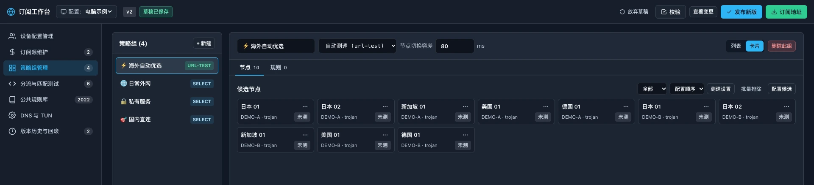
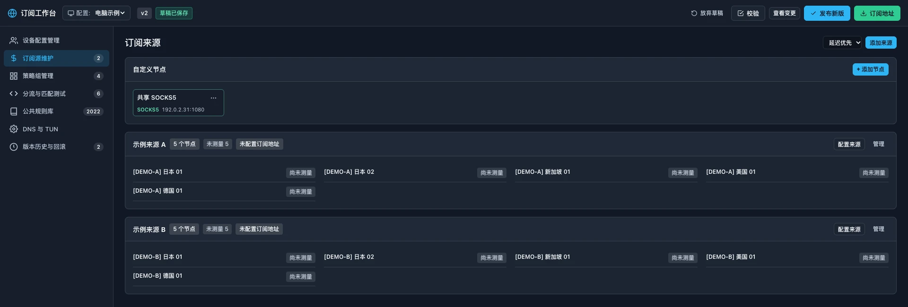
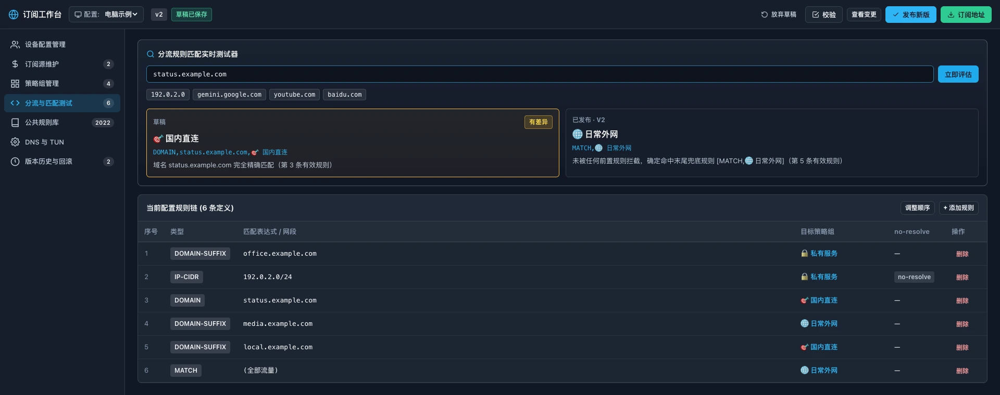
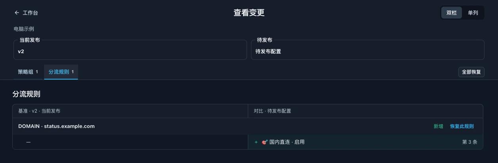

<div align="center">

# 订阅工作台

**一处维护订阅源，为每台设备发布自己的 Clash / Mihomo 配置。**

多来源合并 · 独立设备配置 · 发布前校验与差异对比

[快速开始](#快速开始) · [界面一览](#界面一览) · [远程订阅](#让其他设备通过-tailscale-刷新) · [ISC 许可证](LICENSE)

</div>



在网页里选节点、配策略、验证分流，确认后再发布。手机和电脑可以共用来源和自定义节点，各自选择策略组和前置代理。客户端刷新时只拉取对应设备的已发布版本。

## 快速开始

在仓库根目录运行。需要 **Python 3.10+**。

```bash
python3 -m venv .venv
.venv/bin/python -m pip install -r requirements.txt
.venv/bin/python -m backend.app
```

打开 [本机工作台](http://127.0.0.1:18861/)。首次启动会提供虚构的电脑和手机配置，你可以直接试改策略组、预览差异和发布。要用空数据库起步，在第一次启动时加 `--empty`。也可以用 `--data` 指定数据库文件。

## 界面一览

### 订阅源和自定义节点一起维护

导入多个订阅源，也可以手动登记 HTTP / SOCKS5 节点。策略组可以选整条来源、按条件筛选或单独挑节点，每台设备独立配置。



### 发布前先看请求会走哪里

输入域名或 IP，可以看到命中的规则与目标策略组。有草稿时，页面会并排显示草稿和当前发布版的匹配结果。也可以从公共规则库选用现成的域名规则集。



### 确认具体改动，再发给设备

「查看变更」把当前发布版和待发布配置并排展示。可以撤销单项改动，也可以在版本历史里把旧版恢复为草稿，再检查和发布。



## 从订阅来源到客户端

1. **添加来源。** 在「订阅源与节点」填入订阅 URL，或粘贴含 `proxies` 的 Clash YAML。也可以导入纯 `ss://` 节点列表及其 Base64 编码版本。
2. **组织策略组。** 用顶部的设备选择器切到电脑或手机配置。在「配置候选」里选整条来源、指定节点或其他策略组。手动选择、按优先级回退和自动测速可按组设置。
3. **检查分流。** 添加域名或 IP-CIDR 规则，指定目标策略组。到「分流与匹配测试」输入实际要访问的域名或 IP，核对命中的规则。
4. **发布并导入。** 用「查看变更」核对草稿，然后发布。Python 本机模式可直接下载 `/subscriptions/<配置 ID>.yaml`，例如 [电脑示例 YAML](http://127.0.0.1:18861/subscriptions/desktop.yaml)。配置远程入口后，从「订阅地址」复制对应设备的链接，导入 Clash / Mihomo 客户端。
5. **恢复旧版。** 在「版本历史与回滚」选择「恢复草稿」，检查差异后再发布。恢复到草稿期间，客户端下载的仍是当前发布版本。

## 一个自定义节点，两端分别选路

例如，你已经有一个可访问所需网段的 SOCKS5 服务，电脑能直接连，手机需要先经过 Tailscale。

1. 在「订阅源与节点 → 自定义节点」登记一次 SOCKS5 服务，填写地址、端口和所需的认证信息。
2. 在电脑和手机配置中分别打开「策略组管理 → 配置候选 → 自定义节点与策略组」，把这个 SOCKS5 节点加入各自的策略组。
3. 电脑在前置代理里选「直接连接」。手机选属于该配置的 Tailscale 节点，并把所需的网段规则指向对应策略组。

```text
电脑请求 → 分流规则 → 策略组 → SOCKS5 服务 → 目标网段
手机请求 → 分流规则 → 策略组 → Tailscale → 同一个 SOCKS5 服务 → 目标网段
```

添加 Tailscale 节点时，选择所属的设备配置，并为它填写独立的设备名。发布到支持 Tailscale 出站的客户端后，发起一次命中该节点的请求，再从客户端日志里打开授权链接。Tailscale 节点也可以直接作为策略组成员。

共享节点的地址或认证信息修改后，选用了它的设备可以各自发布。已发布版本保留当时的节点参数。

## 让其他设备通过 Tailscale 刷新

在运行工作台的机器上初始化订阅入口，将示例主机名换成该机器的 Tailscale DNS 名称，然后启动或重启工作台。

```bash
.venv/bin/python -m backend.distribution init \
  --hostname workbench.example-tailnet.ts.net
```

用 Tailscale Serve 配置需要的转发。下表是默认端口。

| 用途 | 访问入口 | 监听地址 |
| --- | --- | --- |
| 本机管理 | 本机浏览器 | `127.0.0.1:18861` |
| 远程只读订阅 | Tailscale HTTPS `8443` | `127.0.0.1:18862` |
| 远程管理（可选） | Tailscale HTTPS `9443` | `127.0.0.1:18863` |

只给设备刷新订阅时，配置只读入口即可。需要远程管理时，将 [管理账号示例](examples/tailnet-admin.example.json) 复制到 `data/private/tailnet-admin.json`，填写允许登录的 Tailscale 账号，再配置管理转发。工作台会检查 Tailscale Serve 提供的登录标识。

### 用 Funnel 外发选中的订阅

在现有的 `data/private/distribution.json` 中增加 `"funnel": {"httpsPort": 10000, "listenPort": 18864}`，保留现有端口和密钥。启动工作台后，将公网 HTTPS `10000` 转发到专用的回环监听 `127.0.0.1:18864`。

```bash
tailscale funnel --bg --https=10000 http://127.0.0.1:18864
```

在要分享的配置里打开「订阅地址」，启用「允许外发」，再复制公网链接。所有配置默认关闭，现用的 `phone` 和 `desktop` 固定为 Tailnet 私有订阅。关闭开关即可撤销公网链接，再次开启会生成新的链接。已下载配置中的代理凭据仍按服务商设定的有效期使用。

原有的订阅和管理端口继续用 Tailscale Serve。公网监听只处理单独授权的 `/share/` 下载路径。

## 数据、配置与开发

- **配置项。** 将 [`.env.example`](.env.example) 复制为 `.env`，按需填写，然后在启动前执行 `set -a; . ./.env; set +a` 导入。设置 `WORKBENCH_MIHOMO` 指定可用的 Mihomo 内核，即可运行工作台的节点测速。
- **保管与备份。** 默认数据目录为 `data/`，可通过 `WORKBENCH_DATA_DIR` 修改。订阅源 URL、节点凭据、下载令牌、SQLite 数据库和生成的订阅 YAML 都应放在私有位置。
- **开发预览与测试。** 可用 Node.js 20+ 执行 `npm start`，打开 [前端预览](http://127.0.0.1:3000/)。`npm test` 在独立的临时目录验证配置发布、历史恢复和 HTTP 接口。

公共规则目录和规则数据来自 [MetaCubeX/meta-rules-dat](https://github.com/MetaCubeX/meta-rules-dat)。工作台源码采用 [ISC 许可证](LICENSE)。
